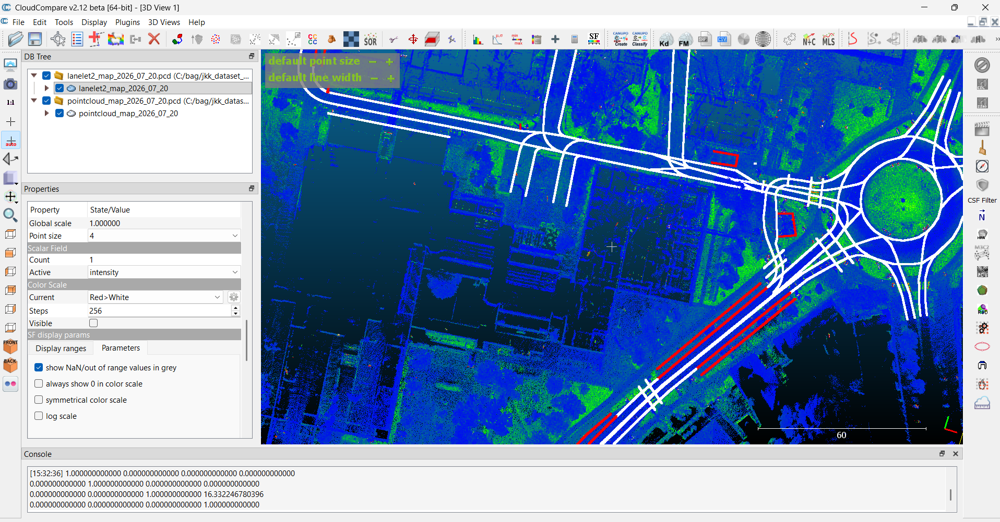

# pointcloud_from_lanelet

Converts a Lanelet2 `.osm` map to a small `.pcd` (`x y z intensity`), so the map can be viewed e.g. in CloudCompare together with the point cloud map.



## Usage

Only `python3` and `numpy` are needed, no ROS.

```bash
python3 lanelet2pcd.py /mnt/c/bag/jkk_dataset_04_campus_2026_07_20/lanelet2_map_2026_07_20.osm
```

The output is saved next to the `.osm` with the same name and `.pcd` extension. An existing file is not overwritten, the output gets a `_1`, `_2`, ... suffix instead.

| Option | Description |
|---|---|
| `-s`, `--step` | point spacing along the lines in metres (default: `0.1`) |
| `-o`, `--output` | output `.pcd` path |
| `-c`, `--centerline` | also add the lanelet centerlines |
| `-f`, `--force` | overwrite the output if it exists |

```bash
python3 lanelet2pcd.py map.osm -s 0.25 --centerline
```

## Notes

- Coordinates come from the `local_x` / `local_y` / `ele` tags, so the result is in the same frame as the point cloud map. Maps with only `lat` / `lon` are not supported.
- The intensity depends on the line type, edit the `INTENSITY` table at the top of the script to change it:

| Line type | Intensity |
|---|---|
| `centerline` (only with `-c`) | 10 |
| `virtual` | 20 |
| other | 30 |
| `parking_lot`, `parking_space` | 40 |
| `road_shoulder` lanelet bounds | 50 |
| `road_border`, `curbstone` | 60 |
| `line_thin` / `dashed` | 80 |
| `line_thin` / `solid` | 100 |
| `line_thick` | 120 |
| `crosswalk` lanelet bounds | 160 |
| `stop_line` | 200 |
| `traffic_sign` | 220 |
| `traffic_light` | 240 |

- In CloudCompare select the cloud, set the active scalar field to `intensity` and pick a color scale (`Red>White` on the screenshot); a larger point size makes the lines easier to see.
