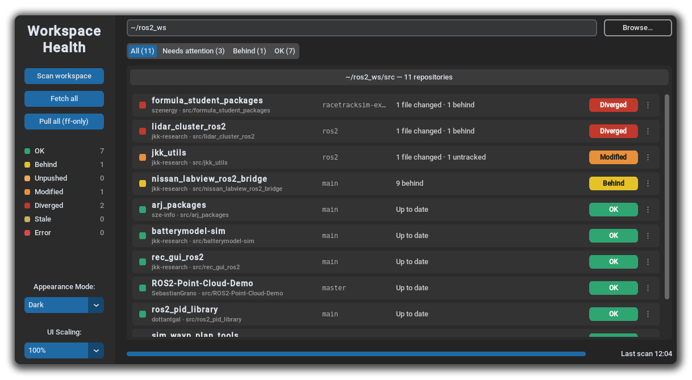

<h1 align="center">workspace_health</h1>

<p align="center">
  <b>A CustomTkinter GUI that shows the state of every GitHub repository cloned into a ROS 2 workspace: the current branch, how many files are changed, and whether the repo is ahead of or behind its remote. You can fetch all repos and fast-forward the ones that are behind from the same window.</b>
</p>

<p align="center">
  
  
  <a href="https://github.com/jkk-research/jkk_utils/blob/ros2/LICENSE">
    
  </a>
  

</p>

<p align="center">
  
</p>


## Install

Requirements: Python 3.10+, `git`, Tk (`sudo apt install python3-tk`) and CustomTkinter. CustomTkinter is not available as a rosdep / apt package, so install it with pip:

``` bash
pip install customtkinter
```

Build the package:

``` bash
cd ~/ros2_ws
colcon build --packages-select workspace_health --symlink-install
source ~/ros2_ws/install/setup.bash
```

## Usage

``` bash
ros2 run workspace_health workspace_health                     # scans ~/ros2_ws
```
``` bash
ros2 run workspace_health workspace_health --ws ~/other_ws     # other workspace
ros2 run workspace_health workspace_health --stale-hours 72    # Stale after 3 days
ros2 run workspace_health workspace_health --ros-args -p ws_path:=~/other_ws -p stale_hours:=72
```

The command-line argument takes priority over the ROS parameter, and the ROS parameter takes priority over the default (`~/ros2_ws`). `~` is expanded.

- **Scan workspace** (or press Enter in the path field) recursively searches `<ws>/src` for git repositories. It stops descending once it finds a repository and skips `build/`, `install/`, `log/` and hidden directories. Only repositories whose `origin` points to `github.com` (https or ssh) are listed. A scan is local only and makes no network calls.
- **Fetch all** runs `git fetch --prune` in every listed repository and then rescans.
- **Pull all (ff-only)** runs `git pull --ff-only` only in repositories whose status is exactly **Behind**. It asks for confirmation first and lists those repositories. The button is disabled when no repository is Behind.
- **Filter**: All · Needs attention (Modified, Unpushed, Diverged, Error) · Behind · OK.
- **Right-click** a row, or click its `⋮` button, for: Open folder, Open on GitHub, Copy path, Open in VS Code, Fetch this repo, Pull (ff-only) this repo. Pull is only enabled when the repository is clean, has no local commits and is behind its upstream.
- Hover over the info text of an **Error** row to see the full git error message.

### Safety

- Git runs through the `git` CLI in a thread pool with 8 workers, so the GUI never freezes.
- Every git call has a timeout (10 s for local commands, 20 s for fetch, 60 s for pull).
- `GIT_TERMINAL_PROMPT=0` and ssh `BatchMode=yes` are set, so a missing credential shows up as **Error** instead of hanging.
- The tool never runs a destructive command (reset, checkout, clean, stash drop). It never pulls a Modified or Diverged repository, and `pull_ff_only` checks this again just before pulling.
- A failed fetch or pull keeps the repository on **Error** until the next successful fetch or pull of that repository.

## Status definitions

Each repository gets exactly one badge. When several labels apply, the one highest in this table wins:

| # | Badge | Color | Condition |
|---|-------|-------|-----------|
| 1 | **Error** | red | a git command failed, fetch/pull failed, remote unreachable, auth missing, or not a valid repo |
| 2 | **Diverged** | red | ahead > 0 **and** behind > 0, **or** modified files **and** behind (a pull would be risky) |
| 3 | **Modified** | orange | modified files > 0 (staged + unstaged, from `git status --porcelain`) |
| 4 | **Unpushed** | orange | ahead > 0, no upstream (or upstream gone), or detached HEAD |
| 5 | **Stale** | yellow | last fetch (mtime of `.git/FETCH_HEAD`) is older than the threshold (default 24 h), or the repo was never fetched |
| 6 | **Behind** | yellow | behind > 0 |
| 7 | **OK** | green | clean, in sync with upstream, recently fetched |

Ahead and behind counts come from `git rev-list --left-right --count HEAD...@{u}`. Untracked files and stashes do not change the badge, but they appear in the info text.

The info text lists only the parts that apply, joined with `·`, for example:

```
3 files changed · 2 untracked · 2 behind · 1 ahead · stash · fetched 3 d ago
```

It shows `Up to date` when nothing applies.

> A freshly cloned repository has no `FETCH_HEAD` yet, so it shows as **Stale** ("never fetched") until you press **Fetch all** once.

## Code layout

- `workspace_health/git_status.py`: pure git logic (discovery, status model, fetch/pull) with no GUI imports
- `workspace_health/gui.py`: the CustomTkinter GUI
- `workspace_health/main.py`: entry point that handles the CLI arguments and ROS parameters

## Tests

``` bash
cd ~/ros2_ws
colcon test --packages-select workspace_health && colcon test-result --verbose
# or directly:
cd ~/ros2_ws/src/jkk_utils/workspace_health && python3 -m pytest test/
```

The tests create temporary git repositories with a bare "remote" and cover OK, Behind, Unpushed, Modified, Diverged, no upstream, upstream gone, detached HEAD, Stale, Error, ff-only pull and the pull refusals, URL parsing and repository discovery.
